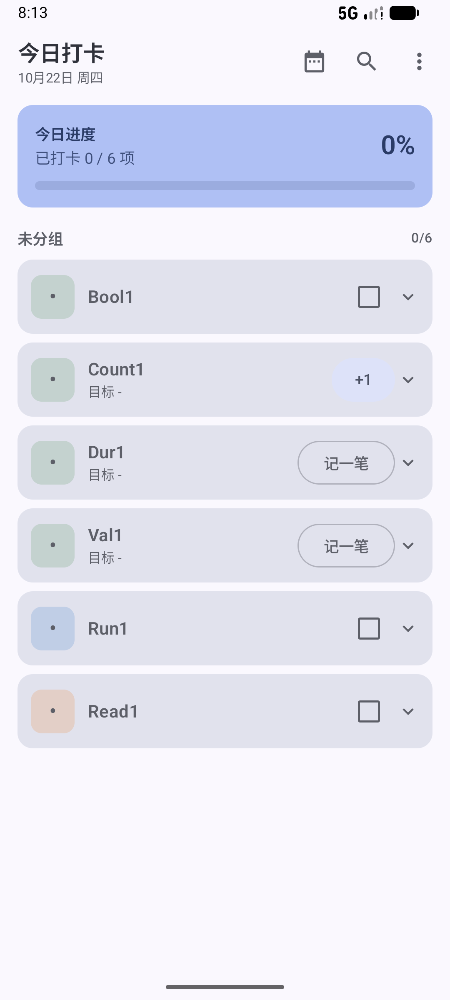
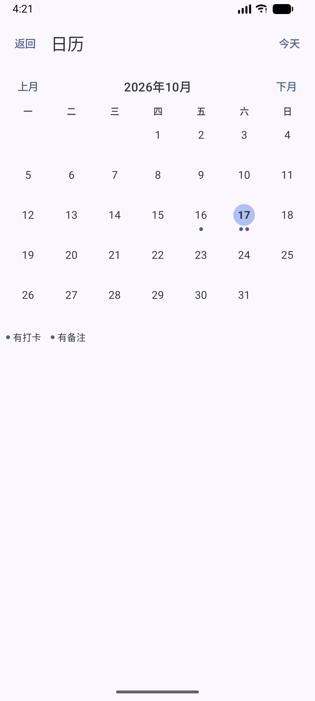
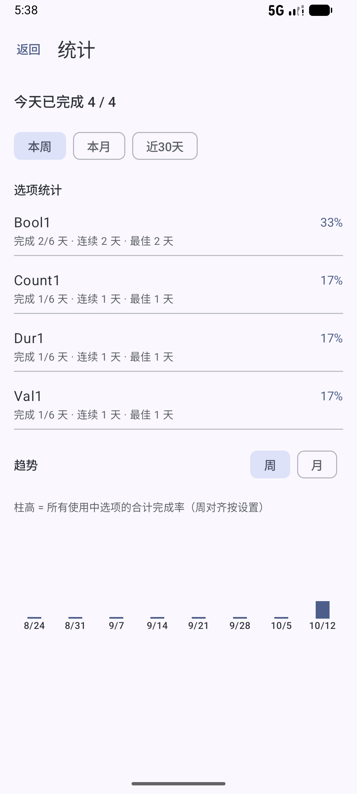

# Daily_Trace (日迹)

**A local-first Android habit tracker.** Everything stays in an on-device Room database: no account, no cloud sync, no analytics. The only outbound request is a version check against GitHub on launch; no local data is ever uploaded. Chinese UI. Open source under the [Apache License 2.0](LICENSE).

[中文说明](README.md)｜[Apache-2.0](LICENSE)

## Highlights

| What | How it works |
|------|--------------|
| **Local-first** | Database, backups and crash logs live in the app's private storage. No account, no sync, no ads or analytics SDKs. |
| **Controlled network scope** | `INTERNET` is requested only to read the latest release tag from GitHub. No device identifiers, no local data uploaded, no ads or analytics SDKs. CI scans the sources and fails if any host other than `api.github.com` / `github.com` appears (text scan, not a hard guarantee). |
| **Immutable history** | Every check-in stores a snapshot of the item's name, color and icon. Renaming, recoloring, archiving or soft-deleting an item never rewrites past records. |

## Screenshots

| Today | Calendar | Stats |
|-------|----------|-------|
|  |  |  |

Screenshot rules: real builds only (release APK on AVD `Medium_Phone_API_37.0`, 1080×2400), files named `<batch>-<index>-<topic>.png` under `docs/截图/`, personal data removed, existing evidence never overwritten.

## Install

> No signed public build has been distributed yet. Download links (GitHub Releases / Gitee attachments) and installation steps will be added here with the first public release.
> Requires Android 7.0+ (`minSdk 24`). Sideloading needs "install unknown apps" permission.

## Features

- Daily / weekly / monthly / custom-interval items, per-item color and icon, manual up/down ordering, filter and recent/frequent shortcuts.
- Check-in, backfill (bounded by `maxBackfillDays`), future plans, skip dates, partial completion, note per record.
- Calendar and per-date detail, weekly/monthly/completion-rate stats, streaks and quota-based goals.
- Exact reminders with quiet hours, notification actions, reboot rescheduling, and optional home-screen widgets.
- Full JSON backup / restore (transactional, validated) and CSV export for analysis.
- Logical day boundary (default: days roll over at 04:00), configurable per settings.

## Tech stack

- Kotlin, Jetpack Compose (Material3), Navigation Compose
- Room 2.8.5 with exported schemas and explicit migrations (database v6)
- Manual dependency injection (`di/Container.kt`)
- Gradle 9.6 / AGP 9.4 / Kotlin 2.2.10 / KSP; minSdk 24, target & compileSdk 37

## Build and test

```powershell
.\gradlew.bat testDebugUnitTest   # JVM + Robolectric unit tests
.\gradlew.bat lintDebug           # static analysis (must stay at 0 errors)
.\gradlew.bat assembleDebug       # debug APK
.\gradlew.bat assembleRelease     # R8 release APK (needs local keystore.properties)
.\scripts\verify.ps1             # unit tests -> lint -> release, with APK size and embedded revision check
```

- Release signing reads `keystore.properties` from the repository root (ignored by git). Without it, every release task fails with an explicit error; there is no fallback to the debug key. See `docs/发布流程.md`.
- CI (`.github/workflows/quality-gate.yml`) runs unit tests, lint and the release build on pushes and pull requests, then checks that the merged manifest declares `INTERNET` and that every host found in `app/src/main/java` is allow-listed (`api.github.com`, `github.com`).

## Data and privacy

- All data stays in the app's private directory; backup files are created only when you export them.
- Permissions declared by the app: `POST_NOTIFICATIONS`, `SCHEDULE_EXACT_ALARM`, `RECEIVE_BOOT_COMPLETED`, `INTERNET`. WorkManager transitively adds `WAKE_LOCK`, `ACCESS_NETWORK_STATE` and `FOREGROUND_SERVICE`; AndroidX also generates one private permission. `INTERNET` is used only to fetch `https://api.github.com/repos/guohong-gh/daily_trace/releases/latest` on launch and from Settings; the request carries no device identifier and uploads nothing.
- No data leaves the device unless you export a backup or CSV yourself.

## Documentation

All project documentation is written in Chinese:

- User manual: `docs/使用手册.md`; FAQ: `docs/常见问题.md`; privacy: `docs/隐私与数据安全.md`
- Architecture: `docs/架构说明.md`; testing: `docs/测试指南.md`; release: `docs/发布流程.md`; data formats: `docs/数据格式说明.md`
- Status and decisions: `docs/项目状态与计划.md`, `docs/决策记录.md`
- Contribution rules: `AGENTS.md` (Chinese) and `贡献指南.md`

## Contributing

Read `AGENTS.md` and `贡献指南.md` first. Each batch must keep unit tests green, lint at 0 errors, a successful release build, and synchronized documentation. Please do not add permissions, dependencies or schema fields without updating tests, migrations and docs.

## License

[Apache License 2.0](LICENSE). Third-party dependencies keep their own licenses (AndroidX, Compose, Room and WorkManager are Apache-2.0).
