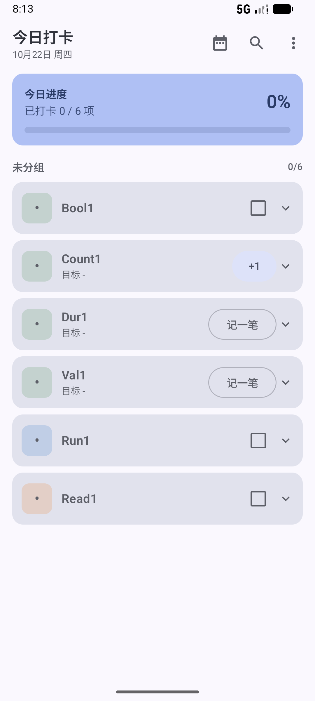
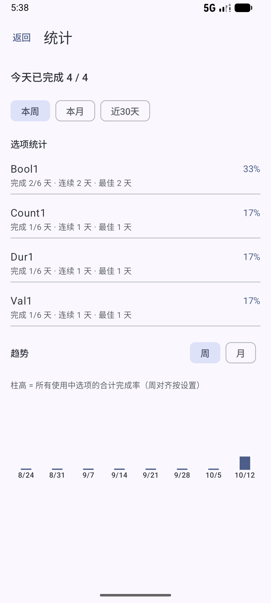

# 日迹（Daily_Trace）

**本地优先的 Android 打卡 / 每日追踪应用**：数据只存本机 Room 数据库，不联网、无账号、无统计上报。中文界面，开源发布。

协议 [Apache-2.0](LICENSE)｜English: [README.en.md](README.en.md)

## 核心卖点

| 卖点 | 具体表现 |
|------|----------|
| **本地优先** | 数据库、备份、崩溃日志均在应用私有目录；无账号、无云同步、无广告或分析 SDK |
| **无网络权限** | Manifest 不申请 `INTERNET`；GitHub Actions 对合并后的 Manifest 做硬检查，一旦出现 `INTERNET` 即构建失败 |
| **历史快照不变** | 展示历史记录只用打卡时的名称 / 颜色 / 图标快照；改名、改色、软删除、归档都不会改写过去 |

## 安装

> 尚未分发正式签名包。首个公开版本发布后，将在此补充 GitHub Releases / Gitee 附件下载与安装说明。
> 要求 Android 7.0+（`minSdk 24`）；首次安装需在系统中允许「安装未知来源应用」。

## 截图

| 今日页 | 日历 | 统计 |
|--------|------|------|
|  |  |  |

截图规范：

- 一律来自真实构建（release 包 + AVD `Medium_Phone_API_37.0`，1080×2400），不得合成或伪造界面。
- 文件名 `<批次>-<序号>-<主题>.png`，存放 `docs/截图/`；历史验收截图只读引用，不覆盖、不删除。
- 截图前清理个人数据与测试选项；不得出现真实用户备份、口令、证书或密钥信息。
- 新增截图需在 `docs/项目状态与计划.md` 的批次记录中登记操作步骤与实际结果。

## 技术栈

- Kotlin + Jetpack Compose (Material3) + Navigation Compose
- Room 2.8.5（schema 导出至 `app/schemas/`，升级必须写显式 Migration）
- 手动依赖注入（`di/Container.kt`，随 Application 生存）
- Gradle 9.6 / AGP 9.4.0 / Kotlin 2.2.10 / KSP；minSdk 24，target & compileSdk 37
- 单元测试：JUnit4 + Robolectric（本地 JVM，无设备即可运行）

## 常用命令

```powershell
.\gradlew.bat testDebugUnitTest   # 单元测试（改代码后必跑）
.\gradlew.bat assembleDebug       # 打 debug APK
.\gradlew.bat installDebug        # 安装到已连接设备/模拟器
.\gradlew.bat assembleRelease     # 打 release APK（R8 开启；签名参数来自本机 keystore.properties）
.\gradlew.bat lintDebug           # 静态检查（发布前必跑，错误必须清零）
```

## 目录结构

```
app/src/main/java/com/gh/daily_trace/
  MainActivity.kt            入口，主题接线
  DailyTraceApp.kt / di/     应用与手动 DI 容器
  data/                      实体、DAO、Repository（数据层，Phase 1 已完成）
  domain/                    业务纯逻辑：time/ 逻辑日与月历网格，checkin/ 打卡写入计划与补卡策略，filter/ 筛选匹配，reminder/ 提醒时刻与免打扰窗口计算，summary/ 每日汇总口径，widget/ 组件数据口径，stats/ 完成率与连续/趋势统计
  reminder/                  提醒设施：AlarmManager 调度、WorkManager 每日汇总、通知渠道与动作、开机/时区变更重排
  widget/                    桌面小组件：RemoteViews 渲染、AppWidgetProvider、快捷打卡接收器
  backup/                    备份：JSON 编解码（BackupCodec）、事务导入导出（BackupManager）、本机自动备份（AutoBackup）
  diagnostics/               诊断：崩溃日志捕获 / 导出（CrashLogManager）、数据检查与安全修复（DataRepairManager）
  ui/                        界面：navigation / today / calendar / datedetail / search / filter / stats / manage / itemedit / settings / common / theme
app/src/test/                单元测试（Robolectric 内存库 + 纯逻辑单测）
```

## 关键领域约定

- 日期一律用「逻辑日」`epochDay`（Long），见 `domain/time/DayClock.kt`：
  当日 `startOfDay`（默认凌晨 4 点）之前算前一天；换算以 `AppSettings.timezone` 为准。
- 日期显示：设置中可选日期语言（跟随系统 / 中文 / English）与格式（跟随语言 / 年-月-日 / 月/日/年 / 日/月/年）；仅影响日期标签，不翻译应用界面，CSV、备份文件名与数据库日期仍用 ISO；默认中文 + 跟随语言。
- 打卡记录带快照（名称/颜色/图标），选项改名、删除后历史展示不变。
- 选项删除为软删除（回收站）；停用 / 归档会从今日列表、日期详情选择器、统计与小组件隐藏，但历史记录仍在日期详情、日历、搜索中可见。
- 同一天多次打卡行为由 `MultiRecordRule` 决定：合并一条 / 累加 / 保留多条。
- 今日页「⭐ 近期常用」：最近 30 天按记录条数取 top 3 的快捷行（总项数 ≥8 才显示，不足 3 个显示实际数量），点击与对应卡片主按钮行为一致（布尔=打卡 / 计数=+1 / 时长·数值=记一笔）；右下「新增」FAB 直达新建选项编辑页（仅今日页）。
- 补卡：只在日期详情页进行；受「补卡上限」（`maxBackfillDays`，0=禁用）限制，落库 `isBackfill=true`。
- 日期备注（第三层备注）：一天一条 `DayNote`，空白即删除；与选项默认备注、单次打卡备注相互独立。
- 提醒：时刻按 `AppSettings.timezone` 解释；精确闹钟权限可用则准点，否则系统可能延迟数分钟（编辑页有提示与引导）；免打扰时段内用「安静」低优先级渠道静默提示；通知动作「打卡」（布尔型直写、幂等）与「稍后 10 分钟」（一次性闹钟，固定 10 分钟）；每次触发自动续排下一次。支持全局暂停：1 / 8 / 24 小时或自定义截止时刻，暂停期间撤下闹钟与通知，到点自动重排。
- 每日汇总：设置页可开启（默认关闭），每天 20:00 / 21:00 / 22:00 或自定义时刻汇总当天完成情况（WorkManager 周期任务，系统可能有几分钟偏差）；内容为「已打卡 X / 总数」，暂停期间同样静默。
- 桌面小组件：4×4「日迹 · 今日」显示今日进度与最多 4 个管理顺序快捷项；布尔未完成项点按直接打卡（来源记为 WIDGET，幂等），已完成 / 非布尔项点按打开 App；数据变化即时刷新，系统 30 分钟周期兜底。
- 统计：期望日模型（DAILY/无规则=每天；DAYS_OF_WEEK=所选周几；TIMES_PER_MONTH / TIMES_PER_WEEK=月度 / 周度配额进度，无日级期望不进完成率分母）；跳过日（SKIPPED 或 allowSkip+skipDates）不计期望也不中断连续；今天未打卡宽限不中断；PARTIAL 计完成受 `partialCountsAsDone`；所有单选项统计按 itemId 隔离；分组统计按组内期望日加权（未分组置末，配额项单独标注，不计日级分母）。
- 大数据量：统计聚合使用「日期 + 选项」索引并移到后台执行；统计页、长按摘要、时间线与日期详情均为懒加载列表，500 选项 / 5 万记录下不一次性组合全部条目（M10-6）。
- 备份：JSON v1 全表快照（选项含回收站；枚举存 name；可空字段存 null；含暂停与每日汇总设置）；导入为单事务全量覆盖，先校验后写入（非法数据不动库），成功后自动重排提醒与汇总任务；本机自动备份在应用启动与退后台时按间隔检查，存 `files/backups/`（保留最近 5 份），设置页可导出到 SAF 自选位置或手动立即备份。
- CSV 导出：设置页可将全部打卡记录导出为 UTF-8 BOM + CRLF 的 CSV（一行一条，含日期、记录时间、选项快照、状态、数值、单位、备注、来源、补卡、时区），供 Excel 等表格分析；JSON 备份仍负责完整恢复。
- 诊断与修复：全局未捕获异常写入 `files/crash_logs/`（含版本、设备与堆栈，最多 10 份，可导出 / 清除）；设置页可检查并安全修复孤立规则 / 提醒、无效分组引用、空日期备注、失效筛选 id 与越界设置，保留打卡历史；`PRAGMA quick_check` 报告数据库完整性，并可从最近本机备份覆盖恢复。

## 界面设计（UI v2，2026-10-17）

- 品牌主题：自建 Material 3 明暗色板（主色「生长绿」，辅助琥珀），完整字阶与形状层级；默认关闭动态取色，设置中可开启 Material You（Android 12+）。
- 通用组件集中在 `ui/common/AppUi.kt`：区块卡片、空态/加载态、徽章、状态胶囊、开关行；页面统一 16dp 边距、卡片列表与 Snackbar 操作反馈。
- 无障碍：图标按钮均带 contentDescription；可点击行 ≥48dp；正文对比度 ≥4.5:1；颜色仅作辅助（选项 emoji 双重编码）。
- 大字号：系统字体缩放 1.3 / 1.5 / 2.0 下主要页面与关键弹窗不裁切；日历密集网格会收紧日期字阶、减少彩点并把隐藏项并入「+N」，趋势图日期标签在大字号下两行显示。
- 响应式：按 600 / 840dp 窗口断点，平板（且高度 ≥480dp）显示「日迹」左侧导航栏，内容最大宽度 1000dp 居中；今日与统计的选项卡片在内容宽度 ≥640dp 时双列，进度 / 筛选 / 分组 / 趋势整行跨列；手机保持单列与原顶栏导航。
- 截图：`docs/截图/`（`01–10` 为旧版；`ui2-01`–`ui2-20` 为 UI v2 前后对比素材；M10 批次见 `m10-*`；M11 品牌与平板见 `m11-*`）。

## 工程流程与文档

- 文档总入口：`docs/文档导航.md`（按「使用 / 开发 / 发版 / AI 代理」四种阅读路径）。
- 协作硬约束：`AGENTS.md`；环境搭建与提交流程：`贡献指南.md`；版本变化：`变更日志.md`。
- 用户操作：`docs/使用手册.md`；常见问题：`docs/常见问题.md`；权限与数据风险：`docs/隐私与数据安全.md`。
- 工程说明：`docs/架构说明.md`、`docs/测试指南.md`、`docs/发布流程.md`、`docs/数据格式说明.md`。
- 状态与验收：`docs/项目状态与计划.md`、`docs/需求差距与验收矩阵.md`；D50 起的新决策写入 `docs/决策记录.md`。
- 一键质量门禁：`.\scripts\verify.ps1`，依次执行单测 → lint → release，并输出测试数、lint 错误 / 警告、APK 大小与内嵌 revision（必须等于当前 HEAD）；失败时非 0 退出。
- CI：`.github/workflows/quality-gate.yml` 在 push / PR 上跑单测 + lint + release，并用 `aapt2 dump permissions` 硬性拦截 `INTERNET` 权限。
- 固定批次流程：单测 → lint → release 构建 → 模拟器走查截图 → 文档同步 → 单批提交并推送 `origin main`。

## 协议

本项目以 [Apache License 2.0](LICENSE) 开源发布：可商用、可修改、可再分发，需保留版权与许可声明，并按第 4 条标注修改；协议同时包含专利授权与免责条款。第三方依赖仍遵循各自协议（AndroidX / Compose / Room / WorkManager 等均为 Apache-2.0）。

## 当前状态与计划

见 `docs/项目状态与计划.md`（含已确认事实、假设、待确认问题、阶段计划与决策记录）。

注：git 已初始化（分支 `main`）并推送至 Gitee：`https://gitee.com/itaita/daily_trace_app`（2026-10-17）。
