# 使用手册

本手册面向实际使用「日迹」的人，按「入口 / 操作步骤 / 结果 / 注意事项」说明每个功能。它描述的是当前代码真实行为，而不是早期设计稿；已知差异集中在 `docs/需求差距与验收矩阵.md` 的“允许偏差”表。

> 适用版本：`versionName 1.0.0`、`versionCode 1`、数据库 v6。
> 适用系统：Android 7.0（API 24）及以上；平板在宽度 ≥600dp 且高度 ≥480dp 时使用左侧导航栏。
> 截图来自历史验收批次，可能保留旧版配色或演示数据；按钮文案与操作路径以本手册和当前版本为准。

## 一、安装与第一次启动

### 1.1 安装前的准备

**入口**：仓库构建产物或他人提供的 `app-release.apk`。

**操作步骤**：

1. 确认手机系统为 Android 7.0 及以上。
2. 在电脑上构建或取得 release 包：`app\build\outputs\apk\release\app-release.apk`。
3. 用数据线连接手机并开启 USB 调试，在仓库根目录执行：

```powershell
adb install -r app\build\outputs\apk\release\app-release.apk
```

也可以把 APK 复制到手机，用文件管理器点击安装；系统会要求允许“安装未知应用”。

**结果**：桌面出现名为「日迹」的应用图标，包名为 `com.gh.daily_trace`。

**注意事项**：

- 当前 release 包使用调试签名，仅适合本机验收与内部试用；正式分发前必须替换独立签名。
- 覆盖安装会保留应用数据；卸载会删除应用私有目录中的数据库、自动备份与崩溃日志。
- 首次启动不需要账号，也不会申请存储权限；导出备份时才通过系统文件选择器访问你指定的位置。

### 1.2 第一次打开

**入口**：桌面「日迹」图标。

**操作步骤**：

1. 打开应用，默认进入「今日打卡」。
2. 首次没有选项时，页面显示「还没有打卡选项」。
3. 点空态里的「创建选项」，或点右下角「＋ 新增」。

**结果**：进入选项编辑页或选项管理页，可以开始创建第一个打卡项。

**注意事项**：

- 应用内置 4 个分组：健康、学习、工作、运动；当前没有独立的分组增删改页面。
- 应用不会自动创建示例打卡项；所有选项都需要自己建立。
- 默认“新一天”从凌晨 4 点开始。凌晨 0:00–3:59 打卡仍算前一天，可在设置中修改；应用停留在前台跨过这个时刻时，今日、日历、日期详情与统计会在约 1 分钟内自动切换到新一天。

### 1.3 界面导航

**入口**：任意主页面。

**操作步骤**：

- 手机（宽度 <600dp）：在「今日打卡」顶栏使用：
  - 日历图标 → 日历；
  - 搜索图标 → 搜索；
  - ⋮ → 统计 / 筛选视图 / 管理选项 / 设置。
- 平板或横屏大窗口（宽度 ≥600dp 且高度 ≥480dp）：使用左侧导航栏的「今日 / 日历 / 统计 / 管理 / 设置」。
- 子页面左上角返回箭头回到上一页；系统返回手势/返回键等效。

**结果**：可以在今日、日历、统计、管理、设置之间切换；搜索和筛选视图从今日页进入。

**注意事项**：

- 手机上不是底部导航栏，统计、管理、设置收在今日页右上角「⋮」菜单里。
- 日历、搜索、日期详情、筛选视图、选项编辑页都是二级页面，左上角都有返回。
- 平板左侧导航栏在横屏高度不足 480dp 时会隐藏，改用各页顶栏返回，避免导航栏被裁切。

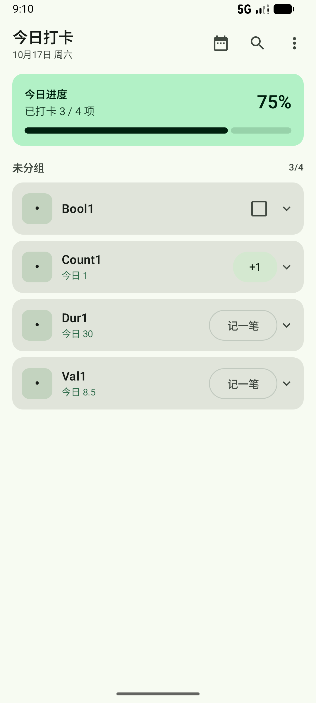

## 二、十分钟完成初始设置

建议按以下顺序设置，后续使用最省心：

1. **建选项**：先建 3–5 个最想坚持的项目，类型可选打卡、计数、时长、数值。
2. **选分组**：编辑选项时选择健康 / 学习 / 工作 / 运动，或保持“不分组”。
3. **设频率**：每天、每周几、每月几次、每周几次或自定义间隔；不确定时选“每天”。
4. **开提醒**：只给真正需要提醒的选项开启，避免通知过多。
5. **调习惯**：设置每周起始日、新一天开始时间、补卡上限。
6. **开自动备份**：设置 → 备份 → 打开“自动备份到本机”，并定期导出到应用外。

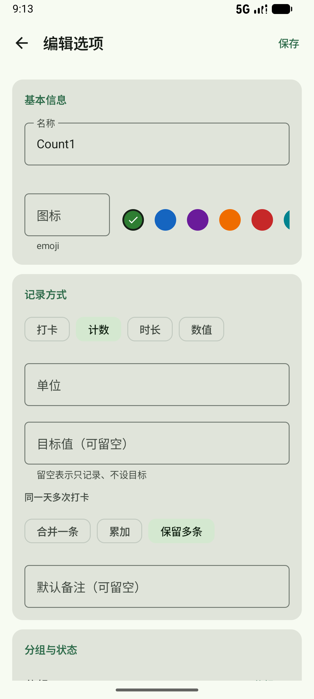

## 三、今日打卡

### 3.1 今日进度

**入口**：今日打卡页顶部。

**操作步骤**：打开应用即可看到，无需操作。

**结果**：显示「今日进度」、百分比、「已打卡 X / Y 项」和线性进度条；全部完成时追加「今日全部完成，太棒了 🎉」。

**注意事项**：

- 今日页使用“百分比 + 线性进度条”，不是环形进度；环形进度只在统计页的“今日完成”卡出现。
- 分母是当前今日列表中的全部选项（含配额项、非期望日、筛选后的范围），不是“今天应该完成”的期望数。
- 分子只统计状态为“完成”的选项；“部分完成”不会让今日进度加一，但统计页默认会把部分完成计入完成率。

### 3.2 ⭐ 近期常用

**入口**：今日页进度卡下方。

**操作步骤**：

1. 当在册选项总数 ≥8 时，区块自动出现。
2. 点某行的「打卡」/「+1」/「记一笔」。

**结果**：行为与对应卡片的主按钮一致：

- 打卡型：直接完成或取消完成；
- 计数型：数值 +1；
- 时长/数值型：打开记录对话框。

**注意事项**：

- 按最近 30 天（含今天）的记录条数取前 3；不足 3 个时显示实际数量，至少 1 个才显示。
- 总选项数少于 8 个时整个区块不显示。
- 近期常用受当前筛选视图约束；它不会替代下方完整列表。

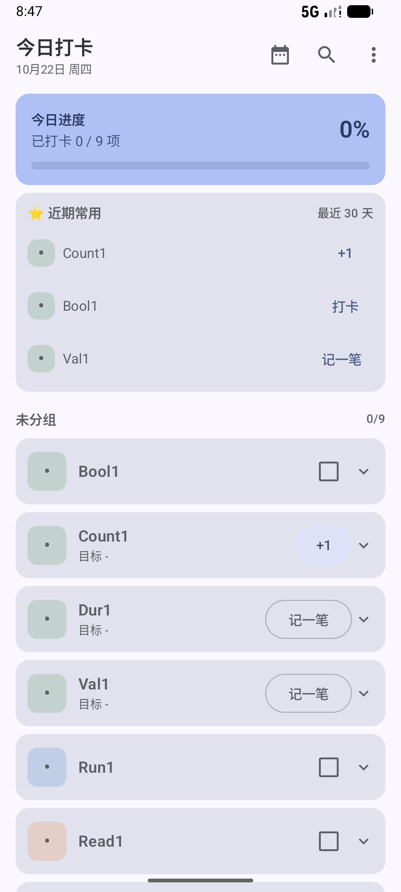

### 3.3 分组与选项卡片

**入口**：今日页进度卡与近期常用下方。

**操作步骤**：

1. 上下滚动查看各分组。
2. 点卡片空白处展开/收起明细。
3. 点右侧主按钮完成打卡。
4. 长按卡片进入多选。

**结果**：分组标题右侧显示「已完成数/组内选项数」；卡片副标题显示今日完成量、目标进度或“今日已跳过”。

**注意事项**：

- 分组顺序固定为内置分组顺序，最后是“未分组”；分组内按管理页的排序显示。
- 卡片展开后可以看当天每条记录（时间、状态、数值、备注），也可逐条删除。
- 布尔型完成后图标变成完成徽章；计数/时长/数值型仍显示选项图标。

### 3.4 打卡型（布尔）

**入口**：今日页选项卡片右侧复选框；或近期常用「打卡」；或通知动作「打卡」。

**操作步骤**：

1. 点复选框。
2. 如需备注，先展开卡片，点「带备注打卡」，填写备注后保存。

**结果**：当天新增一条“完成”记录；再次点复选框会取消当天全部“完成”记录。

**注意事项**：

- 取消是删除当天该选项的 DONE 记录，不是把状态改成“未完成”。
- 通知里的「打卡」只在尚未完成时写入，不会把已完成改成未完成。
- 布尔型不显示数值输入。

### 3.5 计数型

**入口**：今日页卡片右侧「+1」。

**操作步骤**：每点一次「+1」记录一次；需要填写备注或指定数值时，展开卡片点「记一笔（可备注）」。

**结果**：按该选项的“同一天多次打卡”规则写入：

- 合并一条：更新当天最新一条完成记录；
- 累加：在最新一条完成记录上累加；
- 保留多条：每次新增一条。

**注意事项**：

- 新建选项默认“保留多条”，需要累加时请在编辑页改成“累加”。
- 部分完成始终新增一条 PARTIAL 记录，不参与合并/累加。
- 快速 +1 的备注为空；需要备注请用记录对话框。

### 3.6 时长型 / 数值型

**入口**：今日页卡片右侧「记一笔」。

**操作步骤**：

1. 点「记一笔」。
2. 输入数值（可留空，只写备注）。
3. 选择「完成」或「部分完成」。
4. 可填写本次备注。
5. 点「保存」。

**结果**：按状态与合并规则写入记录；卡片副标题显示今日累计值与目标值对比。

**注意事项**：

- 数值框允许留空；只要备注非空也能保存。
- 「部分完成」不会改变今日进度的完成计数，但会累计到今日数值。
- 单位在选项编辑页设置；修改单位不会改写历史记录中的单位快照。

### 3.7 展开明细、删除单条记录

**入口**：今日页卡片空白处。

**操作步骤**：

1. 点卡片展开。
2. 查看当天记录列表。
3. 点记录行右侧垃圾桶图标删除该条。

**结果**：记录立即删除，并出现「已删除该条记录」提示。

**注意事项**：

- 删除单条记录不可撤销；需要保留请先导出备份。
- 删除记录不会删除选项，也不会删除日期备注。
- 计划记录也会出现在明细里；计划本身不计完成。

### 3.8 跳过今天 / 请假

**入口**：今日页展开卡片后的「跳过今天」。

**操作步骤**：

1. 展开卡片。
2. 点「跳过今天」；再次点「取消跳过」可撤销。

**结果**：该选项当天标记为跳过，副标题显示「今日已跳过 · 不计完成率」。

**注意事项**：

- 只有开启“允许跳过/请假”的选项才能跳过；关闭时按钮置灰并提示。
- 跳过不新增记录，而是写入频率规则的跳过日期；不计期望、不中断连续。
- 跳过与“部分完成”不同：跳过表示休息/请假，部分完成表示做了一部分。

### 3.9 长按多选批量打卡

**入口**：今日页长按任意卡片。

**操作步骤**：

1. 长按进入多选，顶栏显示「已选 N 项」。
2. 点其他卡片切换选中；点顶栏「全选 / 取消全选」。
3. 点底部「打卡所选（N）」。
4. 点左上角 × 或按返回退出多选。

**结果**：可批量写入的选项一次性打卡；提示「已记录 N 项（跳过 M 项）」。

**注意事项**：

- 默认值直记：布尔=完成；计数=+1；时长/数值=目标值，没目标则取截至当天最近一次记录值。
- 时长/数值既无目标值也无历史值时，该行复选框不可选，并提示“需先单笔记一次数值，暂不能批量”。
- 已完成布尔项会被跳过，不会重复写入。
- 多选模式下右下角「新增」FAB 隐藏。

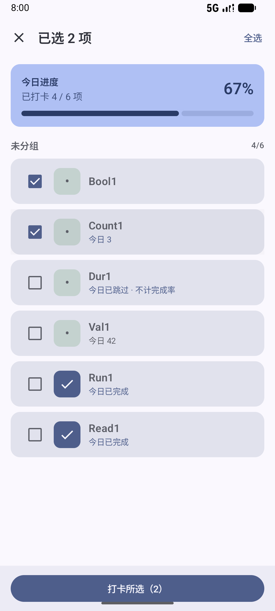

### 3.10 今日页新增选项

**入口**：今日页右下角「＋ 新增」。

**操作步骤**：点 FAB，填写选项后保存。

**结果**：保存后返回，新选项出现在今日列表。

**注意事项**：

- FAB 只在今日页出现，日期详情页没有。
- 多选模式下 FAB 隐藏，退出多选后恢复。
- 也可以从「管理选项」右上角「＋」新建。

## 四、新建与编辑选项

### 4.1 入口

- 今日页「＋ 新增」；
- 管理选项右上角「＋」；
- 管理选项点某个选项 →「编辑」；
- 今日页空态「创建选项」。

**结果**：打开「新建选项」或「编辑选项」页；新建时标题为“新建选项”，已有选项为“编辑选项”。

### 4.2 基本信息

**入口**：编辑页「基本信息」。

**操作步骤**：

1. 填写名称（必填）。
2. 填写 emoji 图标（最多 4 个字符，可留空）。
3. 从 10 个色块中选一个颜色。
4. 点右上角「保存」或底部「创建选项 / 保存修改」。

**结果**：名称、图标、颜色保存；今日页与管理页使用该颜色和图标。

**注意事项**：

- 名称为空不能保存；输入框会提示“名称不能为空”。
- emoji 只是文本，不要求必须是 emoji；留空时列表用默认符号。
- 颜色是辅助识别，图标/文字仍保留，不依赖颜色区分。

### 4.3 记录方式

**入口**：编辑页「记录方式」。

**操作步骤**：

1. 选择类型：打卡 / 计数 / 时长 / 数值。
2. 非打卡型可填单位（如 次、分钟、毫升、公里）。
3. 非打卡型可填目标值（可留空）。
4. 选择同一天多次打卡规则：合并一条 / 累加 / 保留多条。
5. 可填默认备注。

**结果**：今日页按所选类型显示复选框、+1 或“记一笔”。

**注意事项**：

- 目标值只影响进度展示和批量默认值，不会自动判定“完成”；完成仍以是否写入 DONE 记录为准。
- 默认备注当前**只保存到选项并随备份导出，不会自动填入打卡备注**；需要每次备注请在记录对话框填写。
- 新建选项默认“保留多条”；计数类想累计请选“累加”。
- 打卡型没有单位、目标值和多次规则设置。

### 4.4 频率规则

**入口**：编辑页「频率规则」。

**操作步骤**：

1. 选择类型：
   - 每天；
   - 每周几（勾选周一至周日，可多选）；
   - 每月几次（1–31）；
   - 每周几次（1–7）；
   - 自定义（每隔 1–90 天）。
2. 按提示填写数字或勾选星期。
3. 决定是否开启「允许跳过/请假」。

**结果**：统计页按该规则计算期望日、完成率、连续与配额进度。

**注意事项**：

- 每天 / 每周几 / 自定义有“日级期望”，会进入完成率分母。
- 每月几次 / 每周几次是配额，不产生日级期望，不进完成率分母；统计页单独显示「x/N 次」。
- 自定义从保存当天起算，每隔 N 天记一次；修改 N 后从今天重新起算。
- 关闭“允许跳过”后，今日页和日期详情都不能登记跳过。
- 频率只影响统计口径与跳过权限，不会隐藏今日页选项，也不会限制你多打几次。

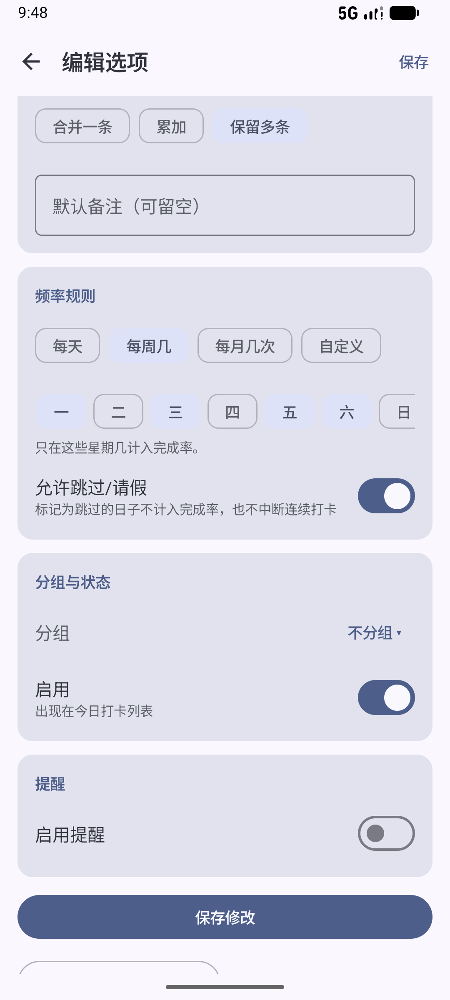

### 4.5 分组与启用状态

**入口**：编辑页「分组与状态」。

**操作步骤**：

1. 点分组名称，在弹窗中选择“不分组”或内置分组。
2. 用「启用」开关控制是否出现在打卡列表。

**结果**：启用且未归档、未删除的选项出现在今日列表、日期详情选择器、统计与小组件。

**注意事项**：

- 当前没有独立的分组管理页，不能新建、改名、改色或删除分组；只能从 4 个内置分组中选择。
- 停用后不再出现在上述使用入口，但历史记录仍保留。
- 重新启用即可恢复显示。

### 4.6 提醒

**入口**：编辑页「提醒」。

**操作步骤**：

1. 打开「启用提醒」。
2. 点提醒时刻，选择时间。
3. 选择重复方式：每天 / 工作日 / 每周；每周可勾选多个星期。
4. 可开启「免打扰时段」，设置开始与结束时间。
5. 如出现权限提示，按提示允许通知或精准提醒。

**结果**：到点发送打卡提醒；免打扰时段内改为静默通知。

**注意事项**：

- 提醒按设置中的时区解释；当前时区固定为 `Asia/Shanghai`，界面暂不提供修改入口。
- Android 13+ 需要通知权限；Android 12+ 精准闹钟需要系统授权，未授权时可能延迟数分钟。
- 免打扰只降低为静默通知，不是完全不发；支持跨午夜时段（如 22:00–07:00）。
- 通知稍后提醒固定 10 分钟，界面暂不提供修改入口。
- 停用、归档、移入回收站后，对应提醒不再调度。

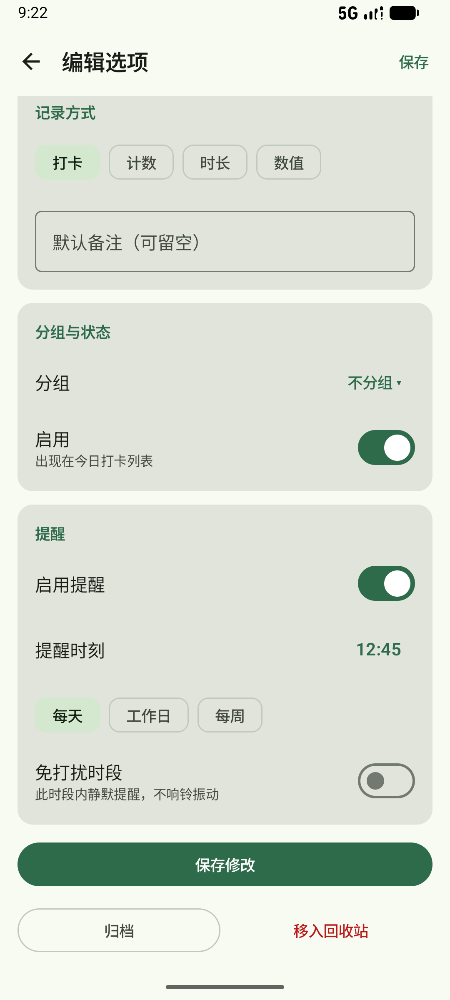

### 4.7 保存、归档与回收站

**入口**：编辑页底部。

**操作步骤**：

- 保存：点右上角「保存」或底部按钮。
- 归档：点「归档」；再次进入可「取消归档」。
- 删除：点「移入回收站」，在确认框点「移入」。

**结果**：

- 归档：从今日列表、日期详情选择器、统计与小组件隐藏；历史记录保留。
- 回收站：选项进入管理页“回收站”，可恢复或彻底删除。

**注意事项**：

- 归档/停用不是删除，历史仍在日期详情、日历、时间线、搜索中可查。
- 回收站中的选项不出现在打卡入口；恢复后重新出现。
- 「彻底删除」在管理页回收站内执行，删除后选项不可恢复，历史打卡记录仍保留为只读快照。
- 删除选项会重排提醒；相关频率规则/提醒若变成孤儿，可由设置页“检查数据”发现。

## 五、选项管理

### 5.1 入口

今日页右上角「⋮」→「管理选项」；平板可直接点左侧「管理」。

**结果**：打开「选项管理」，按状态分为四个分区：使用中、已停用、已归档、回收站；空分区不显示。

**注意事项**：

- 分区标题后的数字是该分区数量。
- 管理页右上角「＋」可新建选项。
- 列表按管理顺序排序；排序只对“使用中”列表生效。

### 5.2 单个选项操作

**入口**：点管理页任意选项行。

**操作步骤**：在弹窗中选择：

- 编辑；
- 上移 / 下移（仅未归档项显示）；
- 停用 / 启用；
- 归档 / 取消归档；
- 移入回收站；
- 回收站中：恢复 / 彻底删除。

**结果**：操作立即生效；弹窗关闭，列表实时更新。

**注意事项**：

- 「上移 / 下移」只在“使用中”列表真正改变顺序；已停用/已归档项不参与排序，按钮即使出现也不会移动。
- 停用与归档都是隐藏，不删除历史；区别是归档有单独分区与批量操作。
- 移入回收站不弹确认；彻底删除会弹确认框。
- 彻底删除后历史记录保留，但选项本身不可恢复。

### 5.3 长按批量操作

**入口**：长按管理页任意一行。

**操作步骤**：

1. 进入多选，顶栏显示「已选 N 项」。
2. 一次只能在一个分区内选择；点其他行切换选中。
3. 点顶栏「全选 / 取消全选」。
4. 按分区使用底部按钮：
   - 使用中 / 已停用：归档、移入回收站；
   - 已归档：取消归档、移入回收站；
   - 回收站：恢复、彻底删除。
5. 点 × 或返回退出多选。

**结果**：批量操作立即执行并提示数量；批量彻底删除会二次确认。

**注意事项**：

- 批量操作不跨分区，避免误把“使用中”和“回收站”混在一起。
- 「停用 / 启用」不支持批量，需要逐个操作。
- 批量归档/移入回收站不弹确认；批量彻底删除会弹确认。

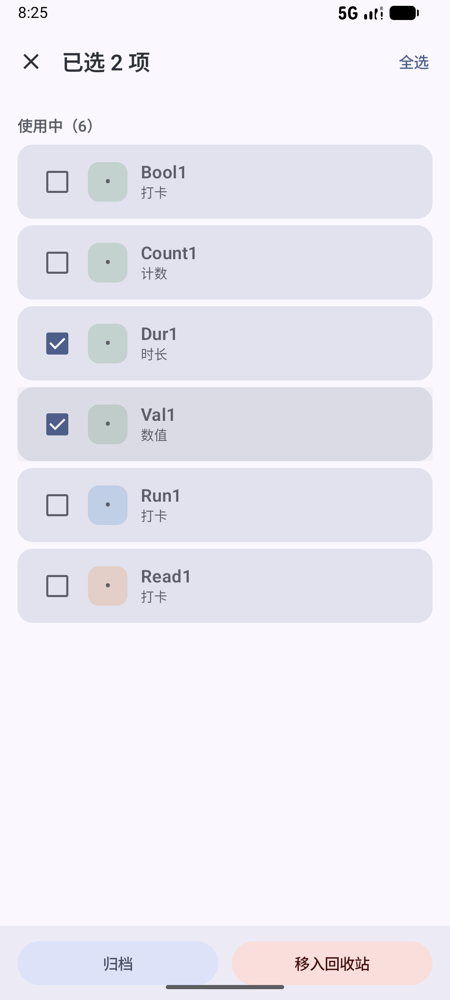

## 六、日历

### 6.1 入口与视图切换

**入口**：今日页顶栏日历图标；平板左侧「日历」。

**操作步骤**：点顶部「月 / 周 / 年 / 时间线」切换视图；点右上角「今天」回到当前日期所在范围。

**结果**：四种视图共享同一份数据与筛选范围。

**注意事项**：

- 视图 tab 只能点击切换，不能左右滑动切换 tab；左右滑动用于各视图自身翻页。
- 已应用筛选时，顶部显示“筛选：视图名”和“标记已按筛选联动”。
- 日历只联动筛选的选项/分组范围，忽略“已打卡/未打卡”日筛选。
- 可翻范围为 1970-01 至 2100-12；到边界停住，不回绕。


### 6.2 月视图

**入口**：日历 →「月」。

**操作步骤**：

1. 左右滑动或点 ‹ › 切换月份。
2. 点标题「2026年10月 ▾」打开年月选择器。
3. 点某一天进入日期详情。
4. 长按有内容的日期查看当日摘要。

**结果**：日期格显示完成项彩点（最多 4 个 +「+N」）与备注点；图例在下方。

**注意事项**：

- 彩点只代表完成/部分完成，同选项同天只一个点；计划与跳过不产点。
- 备注点用第三色，和完成点分开。
- 长按空日不会弹摘要（等同点击进入详情）。
- 年月选择器：‹ › 换年，点 3×4 月网格中的月份直接跳转；远距离跳转不做长动画。

### 6.3 周视图

**入口**：日历 →「周」。

**操作步骤**：

1. 左右滑动或点 ‹ › 切换周。
2. 点格子进入该日期详情。
3. 长按日期查看摘要。

**结果**：行为“选项 × 7 天”的状态网格：

- 实心圆 = 完成；
- 半透明圆 = 部分完成；
- 空心圆 = 计划；
- 灰色短横 = 跳过；
- 空白 = 无记录。

**注意事项**：

- 切换周受 1970–2100 范围限制。
- 归档选项在周视图可能保留历史行；回收站选项不作为行。
- 同一天同选项有完成记录时，跳过不会覆盖完成状态。

### 6.4 年视图

**入口**：日历 →「年」。

**操作步骤**：

1. 上下滚动查看全年。
2. 左右滑动或点 ‹ › 换年。
3. 点格子进入日期详情；长按查看摘要。
4. 点「今天」回到当年，并自动滚到今天附近。

**结果**：7 列热力图，颜色越深表示当天完成的去重选项越多（0 / 1 / 2 / 3 / 4+）；今天有高亮环；底部显示“全年完成 N 项次 · 打卡 M 天”。

**注意事项**：

- 热力图强度只统计 DONE，不统计部分完成、计划、跳过。
- 年视图采用 7 列 × 53/54 行，周起始跟随设置。
- 年份范围 1970–2100；边界停住。

### 6.5 时间线

**入口**：日历 →「时间线」。

**操作步骤**：

1. 上下滚动查看倒序日流。
2. 点卡片进入日期详情；长按查看摘要。
3. 点底部「加载更早（30 天）」继续回溯。

**结果**：只显示有内容的日期（有记录、跳过或日期备注）；默认含今天共 30 天；到最早内容时显示「已到最早记录」。

**注意事项**：

- 时间线不展示未来计划；未来计划请用月/周/年视图或日期详情。
- 点「今天」会重置为最近 30 天并回到顶部。
- 回溯下限为 1970-01-01。

### 6.6 长按当日摘要

**入口**：月/周/年/时间线中长按有内容的日期。

**操作步骤**：查看条目、休息日、日期备注；点「查看详情」进入日期详情，点「关闭」退出。

**结果**：不离开日历即可快速回顾当天。

**注意事项**：

- 条目多时摘要内部可滚动，不会一次性加载全部。
- 摘要中的选项名使用记录快照，选项改名后仍显示当时的名称。
- 摘要受当前筛选范围影响。

## 七、日期详情

### 7.1 入口

- 日历任意视图点日期；
- 时间线点日期卡；
- 搜索结果点记录/日期备注。

**结果**：打开该日期的「日期详情」，标题为格式化后的日期。

**注意事项**：

- 未来日期也能进入，用于添加计划和请假。
- 日期详情是唯一能对过去日期补卡的入口；今日页只能记录今天。

### 7.2 当天备注（第三层备注）

**入口**：日期详情顶部「当天备注」。

**操作步骤**：

1. 输入文字。
2. 点「保存备注」。
3. 需要清空时点「清除」。

**结果**：一天一条备注；保存后提示「备注已保存」；清空即删除该日备注。

**注意事项**：

- 当天备注与选项默认备注、单次打卡备注相互独立。
- 空白视为删除，不会保留空记录。
- 日期备注会出现在日历备注点、长按摘要、时间线与搜索中。

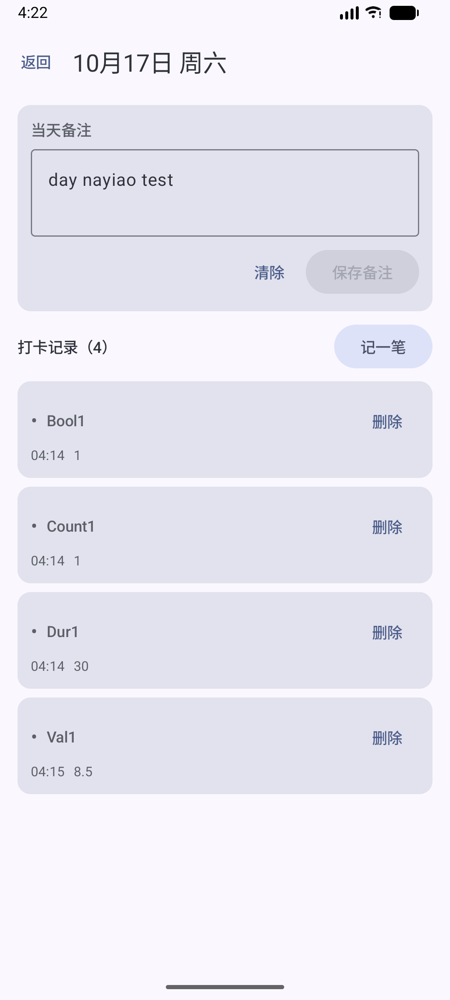

### 7.3 查看与删除记录

**入口**：日期详情「打卡记录（N）」。

**操作步骤**：

1. 查看每条记录的时间、状态、数值、备注与来源标记。
2. 点单条右侧垃圾桶删除。
3. 长按记录进入多选，可批量改备注或批量删除。

**结果**：补卡记录带「补卡」角标；部分完成/计划有对应状态胶囊。

**注意事项**：

- 历史记录使用名称/颜色/图标快照，选项后来改名或删除不影响展示。
- 删除单条记录不可撤销。
- 批量改备注是“统一覆盖”：输入新备注后应用，或点“清除备注”清空。

### 7.4 补卡

**入口**：日期详情 →「补卡」（过去日期且未超出上限）。

**操作步骤**：

1. 点「补卡」打开选项选择器。
2. 点某个选项行，单笔填写数值/备注/状态。
3. 或勾选多项，点「记录所选（N）」批量补卡。
4. 在确认框保存。

**结果**：记录写入所选日期，并标记 `isBackfill=true`，列表显示「补卡」。

**注意事项**：

- 只有今天和“补卡上限”内的过去日期可以补卡；上限在设置中可选禁用/1/3/7/14/30 天。
- 超过上限时入口变成「标记状态」，只能标记跳过，不能补卡或补计划。
- 补卡会按该选项的合并规则写入，并计入历史统计。
- 未来日期不能补卡，只能添加计划。


### 7.5 添加计划（未来日期）

**入口**：未来日期详情 →「添加计划」。

**操作步骤**：

1. 点「添加计划」。
2. 点选项行单笔填写，或勾选多项批量创建。
3. 填写计划数值/备注，点「保存计划」。

**结果**：写入状态为“计划中”的记录，不计完成；当天到来后，今日页会显示“计划：…”提示。

**注意事项**：

- 计划只允许未来日期；今天/过去不能新建计划。
- 同一选项同一天重复添加计划会更新最近一条，不会堆积。
- 计划不会自动变成完成；当天仍需正常打卡。
- 时间线不展示未来计划。

### 7.6 标记跳过 / 请假

**入口**：日期详情 → 选项选择器每行右侧「跳过」；或今日页展开卡片。

**操作步骤**：点「跳过」；再次点「取消跳过」撤销。

**结果**：该日该选项标记为跳过；详情页显示“已跳过：…”。

**注意事项**：

- 任意日期都可标记，包括未来请假；不受补卡上限限制。
- 受选项“允许跳过”开关限制；关闭时按钮禁用。
- 跳过不计完成率、不中断连续。

### 7.7 记录区批量操作

**入口**：日期详情长按任意记录。

**操作步骤**：

1. 进入多选，点其他记录追加选择，或顶栏全选。
2. 点「改备注」：输入统一备注 →「应用」，或「清除备注」。
3. 点「删除」：确认后删除所选记录。

**结果**：批量修改/删除立即生效，并提示数量。

**注意事项**：

- 批量改备注会覆盖所选记录原有备注，不是追加。
- 批量删除不可撤销。
- 返回键先退出多选，不会直接离开页面。

## 八、搜索

### 8.1 入口与关键词

**入口**：今日页顶栏搜索图标。

**操作步骤**：

1. 输入关键词。
2. 等待约 300ms 自动搜索。
3. 点结果卡进入对应日期详情。

**结果**：结果分「打卡记录」与「日期备注」两组，按日期倒序；关键词为空时只显示引导空态。

**注意事项**：

- 搜索范围是单次打卡备注、记录中的选项名称快照、日期备注；不搜索当前选项名（改名后旧记录仍按旧名命中）。
- 不输入关键词不能浏览全部记录。
- 支持部分匹配，不区分简繁转换。

### 8.2 日期范围

**入口**：搜索框下方「不限 / 近 7 天 / 近 30 天 / 自定义」。

**操作步骤**：

1. 选择预设；或点「自定义」。
2. 自定义时点「起始」「结束」选择日期。
3. 起始晚于结束时，系统自动交换。

**结果**：关键词与日期范围同时生效；范围按逻辑日闭区间计算。

**注意事项**：

- “近 7 天/近 30 天”以逻辑今天为终点。
- 自定义范围会保留，便于在预设之间来回切换。
- 搜索不改变任何数据。

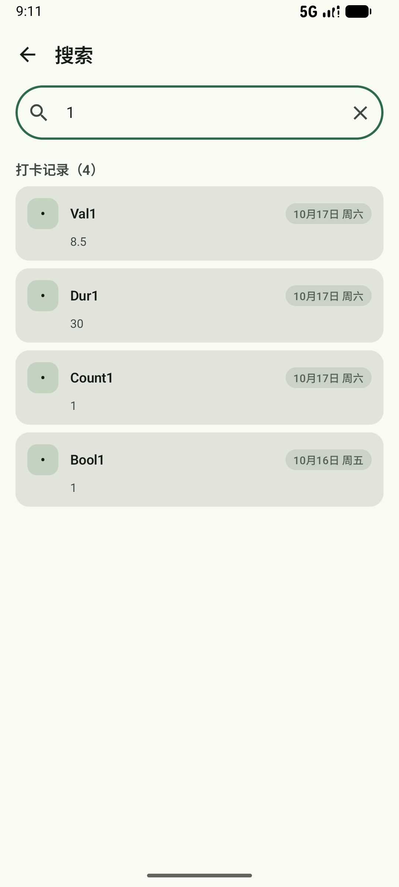

## 九、筛选视图

### 9.1 入口

今日页右上角「⋮」→「筛选视图」。

**结果**：打开筛选视图列表，可新建、编辑、删除、应用。

### 9.2 新建 / 编辑

**入口**：筛选视图页「新建筛选视图」或某卡片「编辑」。

**操作步骤**：

1. 填写视图名称（必填）。
2. 选择范围：
   - 全部选项；
   - 仅选中。
3. 选“仅选中”时，可勾选选项和/或分组；两个区域都有“全选 / 清空”切换。
4. 两边都选时，选择关系：任一命中 / 全部命中。
5. 选择日期状态：全部 / 已打卡 / 未打卡。
6. 点「保存视图」。

**结果**：卡片显示条件摘要；保存后回到列表。

**注意事项**：

- “已打卡”按当天是否有 DONE 记录判断；只有部分完成不算已打卡。
- 只选选项或只选分组时，另一侧视为不限制；两侧都为空等同全部选项。
- 选项/分组行整行可点切换选中；行首徽章与色点只作辅助识别。
- 视图名称不能为空；为空时保存按钮不可用。


### 9.3 应用与清除

**入口**：筛选视图卡片「应用」。

**操作步骤**：点「应用」，自动回到今日页。

**结果**：今日页顶部出现「筛选视图：名称」条，列表只显示命中的选项；可点「清除」恢复全部。

**注意事项**：

- 应用筛选会改变今日进度分母与分组计数。
- 日历只按筛选的选项/分组范围联动，忽略“已打卡/未打卡”。
- 进程被系统回收或应用重启后，已应用筛选会重置为未筛选。
- 删除筛选视图没有确认框，点击「删除」立即生效。


## 十、统计

### 10.1 入口

今日页「⋮」→「统计」；平板左侧「统计」。

**结果**：打开统计页，依次显示今日完成、统计范围、分组统计、选项统计、趋势、周期报告。

**注意事项**：

- 统计只包含“使用中”的选项（启用、未归档、未删除）；停用/归档/回收站选项不计入。
- 统计在后台聚合，数据量大时首次进入可能需要几秒。
- 回到前台会刷新；应用停留在前台跨过逻辑日边界时也会自动刷新，“今日”随之变化。

### 10.2 今日完成与统计范围

**入口**：统计页顶部；范围 chips。

**操作步骤**：选择「本周 / 本月 / 近30天」。

**结果**：

- 今日完成卡：环形进度 + 完成数/总数 + 百分比；
- 范围决定分组完成率、选项完成率与连续计算的窗口。

**注意事项**：

- “本周”从设置的每周起始日到今天；“本月”从 1 日到今天；“近30天”含今天共 30 天。
- 今日进度分母是全部使用中选项，与今日页一致（但今日页还受筛选影响）。
- 部分完成默认计入完成率（设置项固定为 true，无界面开关）。

### 10.3 分组统计

**入口**：统计页「分组统计」。

**结果**：每个有使用中选项的分组显示加粗完成率、选项数、完成项次/期望项次；含配额项时额外标注；未分组排最后。

**注意事项**：

- 分组完成率按组内期望日加权，不是各组百分比的平均。
- 配额项没有日级期望，不进分母，只标注“含 N 个配额项”。
- 空分组不显示。

### 10.4 选项统计

**入口**：统计页「选项统计」。

**结果**：每个选项显示完成率、进度条、完成天数/期望天数、当前连续、最佳连续、全时段累计。

**注意事项**：

- 连续只对非配额项显示；配额项显示“按本周/本月配额统计，不计算连续”。
- “累计”是全时段总量，不随上方范围切换；布尔=完成次数，计数=数值合计，时长按分钟友好化。
- 部分完成会在累计行单独注记；是否计入完成率由固定设置决定。
- 今天尚未打卡不会中断连续（宽限到当天结束）。

### 10.5 趋势

**入口**：统计页「趋势」，选择「周 / 月」。

**结果**：周模式显示最近 8 周，月模式显示最近 6 个月；柱高为当期所有使用中选项的合计完成率；无期望数据时柱体为灰色。

**注意事项**：

- 趋势按范围独立计算，不受上方“统计范围”影响。
- 周趋势按设置的每周起始日对齐。
- 部分完成计入与否沿用全局设置。

### 10.6 周期报告

**入口**：统计页「周期报告」，选择「周报 / 月报」。

**结果**：显示当期完成率、完成项次、打卡天数、部分完成条数、最佳日、最勤选项、与上期对比。

**注意事项**：

- 周报=本周（按每周起始日）到今天；月报=本月 1 日到今天。
- 上期是紧邻的等长时段，仅统计使用中选项。
- 完成率使用期望日口径；完成项次/打卡天数/最佳日/最勤选项使用实际完成口径。
- “最勤选项”最多 3 个，并列时按管理顺序。

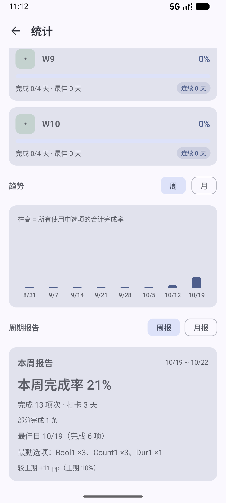

## 十一、提醒与每日汇总

### 11.1 单个选项提醒

**入口**：编辑选项 →「提醒」；设置页 →「提醒」可查看暂停与汇总。

**操作步骤**：

1. 打开「启用提醒」。
2. 设置时刻。
3. 选择每天 / 工作日 / 每周（可多选星期）。
4. 可选免打扰时段。
5. 保存选项。

**结果**：到点发送通知；通知标题为“打卡提醒：选项名”。

**注意事项**：

- 免打扰时段内使用低优先级“安静”渠道，无声音/振动，但仍会显示通知。
- 修改选项后会自动重排提醒；停用/归档/删除后不再提醒。
- 时区固定，跨时区旅行时提醒仍按 `Asia/Shanghai` 解释。

### 11.2 通知上的操作

**入口**：收到提醒后下拉通知。

**操作步骤**：

- 打卡型：点「打卡」直接完成；或点「稍后 10 分钟」。
- 非打卡型：没有「打卡」按钮，点「稍后 10 分钟」，或点通知本体打开应用记录。
- 点通知本体打开 App。

**结果**：打卡成功会撤下通知；稍后会在 10 分钟后再次提醒一次。

**注意事项**：

- 「打卡」是幂等的：已完成时不会重复写入。
- 「稍后」是一次性闹钟，不会改变原有每日/每周提醒系列。
- 稍后分钟数固定 10，界面暂无修改入口。
- 通知被系统清理/用户划掉后不会自动重发。

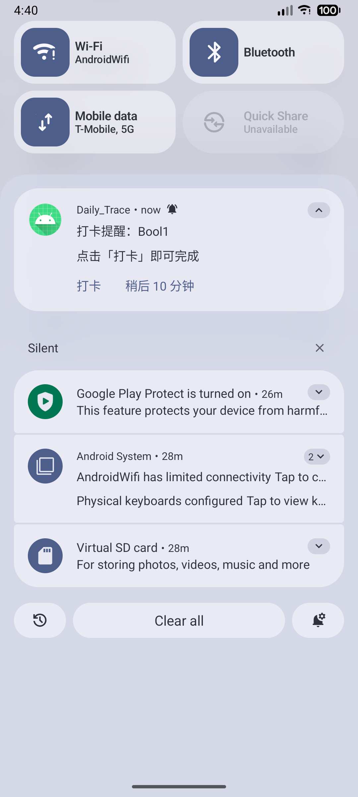

### 11.3 权限

**入口**：编辑页提醒区的权限提示。

**操作步骤**：

- 通知未授权：点「允许通知」，在系统弹窗允许。
- 精准闹钟未授权：点「去允许精准提醒」，在系统设置中允许。

**结果**：授权后提醒可正常显示并尽量准点。

**注意事项**：

- Android 13+ 才有通知运行时权限；更低版本默认允许，但用户仍可在系统设置关闭。
- 未授权精准闹钟时，系统可能把提醒延迟数分钟；这不是应用崩溃。
- 部分厂商的省电策略会进一步限制后台提醒，需要把应用加入白名单。

### 11.4 全局暂停提醒

**入口**：设置 →「提醒」。

**操作步骤**：

1. 点「1 小时 / 8 小时 / 24 小时」，或点「自定义」。
2. 自定义时先选截止日期，再选时刻，点「暂停」。

**结果**：暂停期间撤下所有提醒闹钟与已发通知；页面显示“已暂停提醒”和恢复时间；到点自动恢复。

**注意事项**：

- 暂停也覆盖“稍后提醒”和每日汇总。
- 点「立即恢复」可提前结束暂停。
- 恢复后按原规则重新调度，不会补发暂停期间错过的提醒。
- 自定义截止时刻必须晚于当前时间。

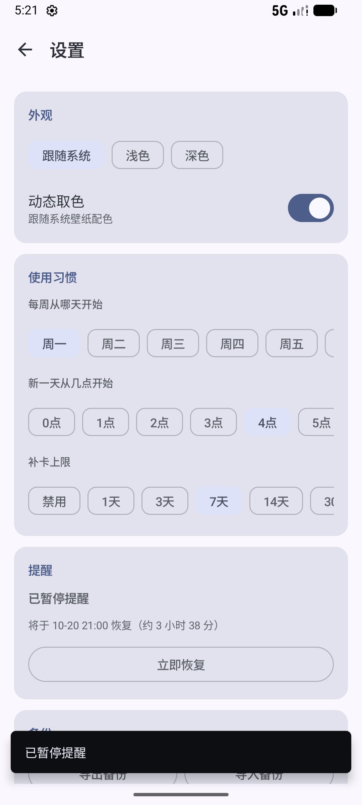

### 11.5 每日汇总提醒

**入口**：设置 →「提醒」→「每日汇总提醒」。

**操作步骤**：

1. 打开开关。
2. 选择 20:00 / 21:00 / 22:00，或点「自定义」选时间。

**结果**：每天固定时刻发送一条汇总通知，内容为“今天已打卡 X / Y 项，还有 Z 项未完成”；全部完成时显示庆祝文案。

**注意事项**：

- 默认关闭；使用 WorkManager 周期任务，系统调度可能有几分钟偏差。
- 分母是全部使用中选项，分子是当天有 DONE 记录的去重选项数。
- 暂停提醒、通知权限关闭时会静默。
- 跨逻辑日按设置的新一天开始时间计算。

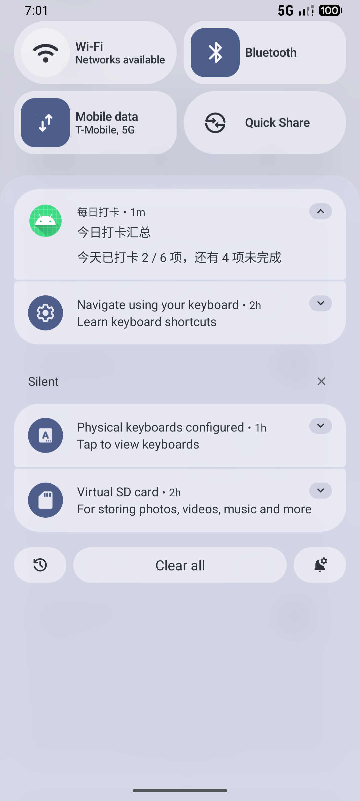

## 十二、桌面小组件

### 12.1 添加

**入口**：手机桌面 → 长按空白处 → 小组件 → 找到「日迹 · 今日」。

**操作步骤**：把 4×4 组件拖到桌面。

**结果**：显示今日进度条、完成数和最多 4 个快捷选项。

**注意事项**：

- 只有一种 4×4 尺寸；所有实例展示同一份数据。
- 快捷项取管理顺序前 4 个使用中选项。
- 不同启动器的添加路径略有差异。

### 12.2 使用

**入口**：桌面小组件。

**操作步骤**：

- 布尔型未完成：点快捷项直接打卡（来源记为“小组件”）。
- 已完成或非布尔型：点按打开 App。

**结果**：打卡后组件进度即时刷新；系统也会每 30 分钟兜底刷新。

**注意事项**：

- 组件打卡是幂等的，不会重复写入。
- 非布尔型不能在组件上填数值，必须打开 App。
- 强制停止应用后，组件可能暂时无法刷新，重新打开 App 即可恢复。


## 十三、设置

### 13.1 外观

**入口**：设置 →「外观」。

**操作步骤**：

- 主题：跟随系统 / 浅色 / 深色。
- 动态取色：Android 12+ 可开关，默认关闭。

**结果**：界面即时切换主题与配色。

**注意事项**：

- 动态取色依赖系统壁纸；Android 12 以下开关不可用。
- 主题选择立即保存，不需要额外确认。

### 13.2 日期与语言

**入口**：设置 →「日期与语言」。

**操作步骤**：

1. 选择日期语言：跟随系统 / 中文 / English。
2. 选择日期格式：跟随语言 / 年-月-日 / 月/日/年 / 日/月/年。
3. 查看下方预览。

**结果**：日期标签按选择显示。

**注意事项**：

- 只影响日期显示，应用界面仍为中文；不提供界面语言切换。
- CSV、备份文件名、数据库日期仍使用 ISO 格式，不受此设置影响。
- 修改后今日页、日历、详情、搜索、时间线、摘要一起生效。

### 13.3 使用习惯

**入口**：设置 →「使用习惯」。

**操作步骤**：

- 每周从哪天开始：周一至周日。
- 新一天从几点开始：0–6 点。
- 补卡上限：禁用 / 1 / 3 / 7 / 14 / 30 天。

**结果**：影响日历周起始、统计周窗口、逻辑日边界与可补卡范围。

**注意事项**：

- 默认周一、4 点、7 天。
- 修改“新一天”不会移动已有记录的日期；只影响之后的“今天”判定。
- 补卡上限设为“禁用”后，过去日期只能标记跳过，不能补卡。

### 13.4 提醒

**入口**：设置 →「提醒」。

**内容**：全局暂停、每日汇总开关与时间。详见第十一节。

### 13.5 备份

**入口**：设置 →「备份」。

**内容**：

- 导出备份（JSON）；
- 导入备份；
- 导出 CSV（打卡记录）；
- 自动备份到本机（开关 + 间隔）；
- 立即备份到本机；
- 本机备份份数与最近时间。

**注意事项**：

- 导出/导入使用系统文件选择器，不需要存储权限。
- 导入是覆盖，不是合并；详见第十四节。
- 自动备份存在应用私有目录，卸载会一并删除；重要数据请额外导出到应用外。

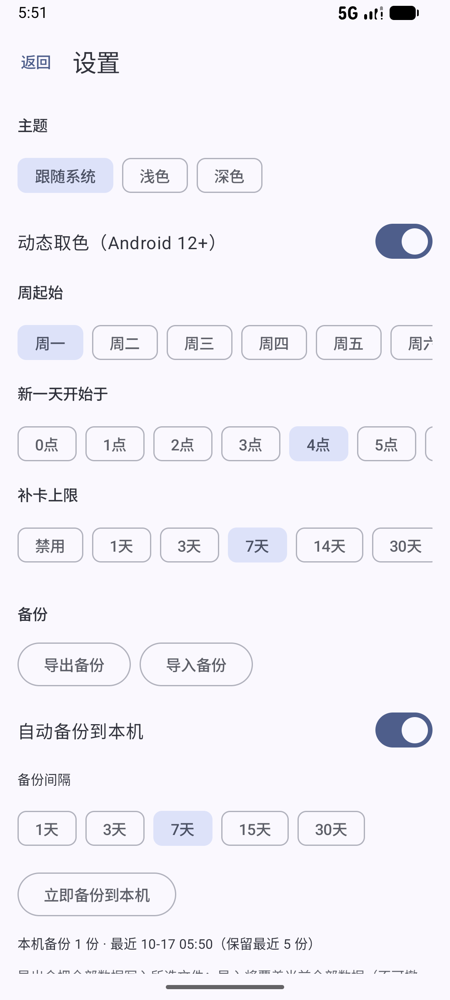

### 13.6 诊断与修复

**入口**：设置 →「诊断与修复」。

**操作步骤**：

1. 点「检查数据」。
2. 查看报告：数量、数据库完整性、孤立规则/提醒、无效分组、空备注、失效筛选、设置越界。
3. 有可修复项时点「修复」；数据库完整性失败时不要修复，改用备份恢复。
4. 可「从最近本机备份恢复」。
5. 崩溃日志可「导出崩溃日志」或「清除」。

**结果**：安全修复不删除打卡历史；报告会说明每类问题。

**注意事项**：

- 修复只处理可由数据自身推导的不一致，不做猜测性补数据。
- 孤儿记录（选项彻底删除后留下的历史）只统计、不删除，仍可在日期详情/搜索查看。
- 从最近备份恢复是覆盖操作，不可撤销。
- 崩溃日志最多 10 份，只含版本、设备与堆栈。

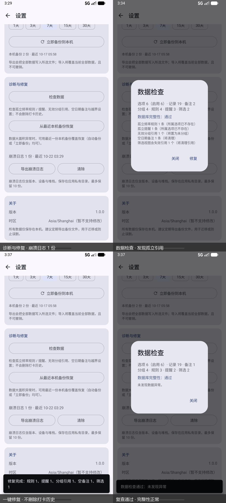

### 13.7 关于

**入口**：设置 →「关于」。

**内容**：版本号、时区（`Asia/Shanghai`，暂不支持修改）、本地数据提示。

**注意事项**：

- 应用没有账号、云同步或网络上传。
- 需要迁移设备时，用“导出备份”再在新设备“导入备份”。

## 十四、备份、恢复与 CSV

### 14.1 导出 JSON 备份

**入口**：设置 → 备份 →「导出备份」。

**操作步骤**：

1. 点「导出备份」。
2. 在系统文件选择器中选择位置，文件名默认 `daily_trace_backup_YYYYMMDD.json`。
3. 确认保存。

**结果**：生成完整 JSON 快照，包含选项（含回收站）、记录、日期备注、分组、提醒、筛选视图、频率规则和设置。

**注意事项**：

- 备份是明文 JSON，未加密；请放在受控位置。
- 备份包含设置中的暂停/汇总状态，导入后会一起覆盖。
- 不包含崩溃日志、自动备份文件本身、系统通知。
- 建议在导入、卸载、换机、批量删除前先导出。

### 14.2 导入 JSON 备份

**入口**：设置 → 备份 →「导入备份」。

**操作步骤**：

1. 选择 JSON 文件。
2. 在确认框点「覆盖导入」。

**结果**：校验通过后，在单个事务内全量替换当前数据；成功后重排提醒与汇总。

**注意事项**：

- 导入是**全量覆盖**，不是合并；当前数据会被替换且不可撤销。
- 文件格式/版本不对、必需字段缺失时会报错，库内数据保持不变。
- 旧备份缺少新字段时使用默认值；当前只支持备份版本 1。
- 导入后建议检查选项、记录、提醒是否符合预期。

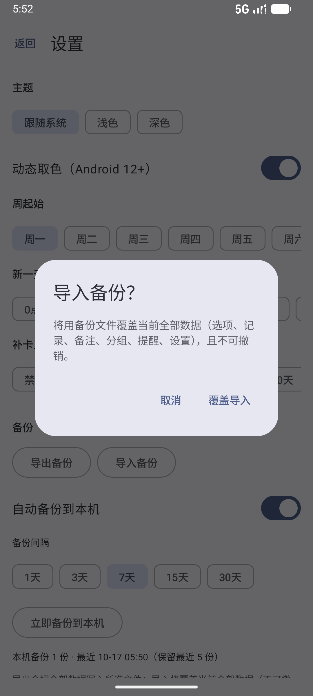

### 14.3 自动备份与立即备份

**入口**：设置 → 备份。

**操作步骤**：

1. 打开「自动备份到本机」。
2. 选择间隔：1/3/7/15/30 天。
3. 需要马上保存时点「立即备份到本机」。

**结果**：备份写入应用私有目录 `files/backups/`，最多保留最近 5 份；页面显示份数与最近时间。

**注意事项**：

- 自动备份在应用启动、退到后台时检查是否到期；不是定时后台服务。
- 「立即备份」忽略自动备份开关与间隔，总是写一份。
- 私有目录中的备份卸载即丢失，不能替代导出到应用外。

### 14.4 从最近本机备份恢复

**入口**：设置 → 诊断与修复 →「从最近本机备份恢复」。

**操作步骤**：确认后点「覆盖恢复」。

**结果**：用最近一份本机备份覆盖全部数据。

**注意事项**：

- 与导入一样是全量覆盖，不可撤销。
- 没有本机备份时按钮禁用。
- 数据库完整性错误时，优先用此功能恢复，不要反复点“修复”。

### 14.5 导出 CSV

**入口**：设置 → 备份 →「导出 CSV（打卡记录）」。

**操作步骤**：选择位置并保存，默认文件名 `daily_trace_records_YYYYMMDD.csv`。

**结果**：导出全部打卡记录，一行一条，UTF-8 BOM + CRLF，可直接用 Excel 打开。

**注意事项**：

- CSV 含日期、记录时间、选项快照、状态、数值、单位、备注、来源、补卡、时区。
- 状态包括完成、部分完成、跳过、计划中；旧数据中的 SKIPPED 记录也会导出。
- CSV 只用于分析，不能用来恢复；恢复请用 JSON 备份。
- 文本中的公式前缀会被转义，避免表格公式注入。

## 十五、主题、大字号与平板

### 15.1 深色 / 浅色 / 动态取色

**入口**：设置 → 外观。

**结果**：整机界面切换主题；动态取色在 Android 12+ 可跟随壁纸。

**注意事项**：

- 默认跟随系统；动态取色默认关闭。
- 主题切换不影响数据与统计口径。

### 15.2 大字号

**入口**：系统设置 → 显示 → 字体大小 / 显示大小。

**操作步骤**：把系统字体放大到 1.3 / 1.5 / 2.0 倍，回到应用查看。

**结果**：主要页面与关键弹窗自动适配；日历密集网格会收紧日期字阶、减少彩点并把隐藏项并入“+N”。

**注意事项**：

- 应用内没有独立的字号开关，完全跟随系统字体缩放。
- 极大字号下若仍有裁切，请记录页面与机型，按缺陷处理。
- 日历、周视图、年视图、趋势图的标签会随字号调整。

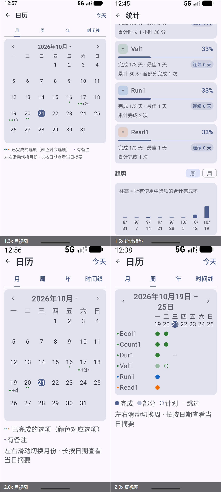

### 15.3 平板与横屏

**入口**：在宽度 ≥600dp 的设备/窗口打开应用。

**结果**：左侧显示「今日 / 日历 / 统计 / 管理 / 设置」导航栏；内容最大宽度 1000dp 居中；今日与统计在内容宽度 ≥640dp 时双列。

**注意事项**：

- 横屏手机高度不足 480dp 时不显示左侧导航栏，仍用顶栏返回。
- 平板布局不改变功能与数据，只是重新排布。
- 分屏/自由窗口会按实际宽度重新判断布局。

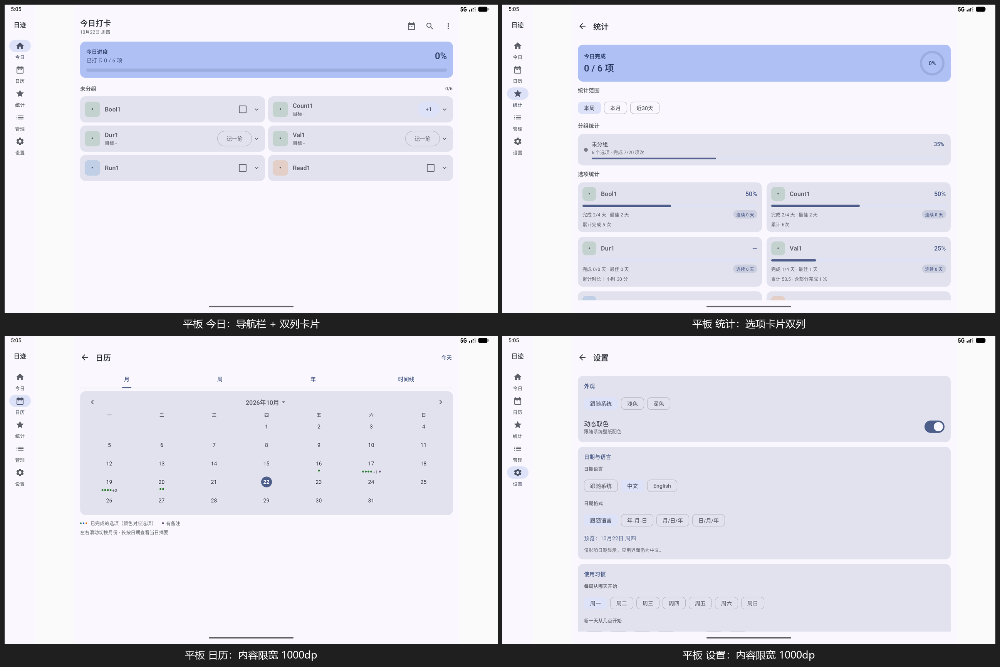

## 十六、数据在哪里

- 数据库、自动备份、崩溃日志都在应用私有目录，其他应用通常无法直接读取。
- 导出的 JSON/CSV 由系统文件选择器写到用户指定位置，离开私有目录后不再受应用保护。
- 应用没有网络权限，不会上传数据；没有账号、云同步、广告或分析 SDK。
- 卸载应用会删除私有数据；系统云备份是否包含应用数据取决于系统与厂商设置。
- 更完整的权限、存储位置与风险边界见 `docs/隐私与数据安全.md`。

## 十七、常见操作速查

| 想做什么 | 入口 |
|----------|------|
| 建一个新打卡项 | 今日页「＋ 新增」/ 管理页「＋」 |
| 给今天打卡 | 今日页卡片主按钮 / 通知「打卡」/ 小组件 |
| 补昨天的卡 | 日历 → 点昨天 →「补卡」 |
| 给未来某天做计划 | 日历 → 点未来日期 →「添加计划」 |
| 请假/休息一天 | 今日页展开 →「跳过今天」，或日期详情选择器「跳过」 |
| 写一天的整体感想 | 日期详情 →「当天备注」 |
| 找某条备注 | 今日页搜索图标 |
| 只看某组选项 | 筛选视图 → 应用 |
| 看完成率和连续 | 统计 → 选项统计 |
| 看周报/月报 | 统计 → 周期报告 |
| 暂停所有提醒 | 设置 → 提醒 → 1/8/24 小时或自定义 |
| 换手机 | 旧机导出备份 → 新机导入备份 |
| 导出给 Excel | 设置 → 备份 → 导出 CSV |
| 应用变慢/数据异常 | 设置 → 诊断与修复 → 检查数据 |
| 字号太小 | 系统设置调大字体，应用内无独立开关 |

## 十八、相关文档

- `README.md`：项目定位、构建命令、目录结构。
- `docs/常见问题.md`：按现象排查。
- `docs/隐私与数据安全.md`：权限、存储、备份风险。
- `docs/数据格式说明.md`：数据库、备份 JSON、CSV 口径。
- `docs/需求差距与验收矩阵.md`：当前限制与允许偏差。
- `docs/文档导航.md`：全部文档入口。
